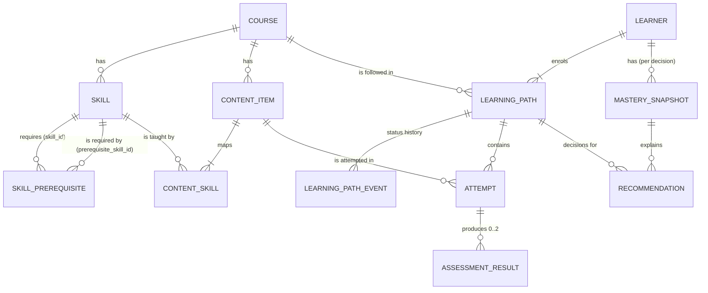

# Design notes

This document explains **what** was built, **why** each decision was made, and
**what it does not do**. Field-level details are in [DATA_DICTIONARY.md](DATA_DICTIONARY.md)
(generated from `skillpath/schema.py`).

## 1. Problem in my own words

A learning platform must tell each learner *what to do next*. A good suggestion:

* only uses skills the learner is actually ready for (prerequisites),
* is at the right difficulty for what the learner has shown so far,
* can be explained (reason code + rationale),
* is honest about the moments where no good suggestion exists (exceptions for a human),
* is built on data whose integrity can be proved.

No real learner data is available, so the project also has to **generate a
realistic synthetic dataset** with known flaws and prove that the flaws are found.

## 2. Architecture

```
schema.py ─────────────┬──> validator rules, SQL DDL, data dictionary, schema.json
                       │
generate.py ──> valid baseline (catalog, learners, paths, simulated attempts)
   │               └─ derived: assessment_result, path events/state, account status
inject.py (A) ──> learners looping without progress (real behaviour)
inject.py (B) ──> corrupted source rows (bad timestamps, orphan skill mappings)
recommend.py ──> decisions on 5 dates -> recommendation + mastery_snapshot
inject.py (C) ──> bad decision records (prerequisite violation, future-leaking mastery)
io.py ──> CSV / JSONL / SQL seed + manifest (row counts, sha256)
validate.py ──> reads the files back, ~200 checks, issues_detected.csv
evaluate.py ──> metrics.json (temporal split, offline outcomes, P/R vs ground truth)
report.py ──> report.html
```

Every module is plain Python + pandas/numpy. No ML library, no network, no
database server: anyone can run it in a minute.

## 3. Data model



Key choices

| Choice | Why |
|---|---|
| `skill_prerequisite` and `content_skill` are **bridge tables** | both relationships are many-to-many |
| `learning_path_event` is **append-only**; `learning_path.current_status` is derived from it | the brief asks not to overwrite history; the validator re-derives the whole history from attempts and requires an exact match |
| `assessment_result` is **per skill** (1 attempt → 1–2 results) | an item can evidence a primary skill (weight 1.0) and a secondary one (0.5) |
| `mastery_snapshot` table | decisions must be traceable: you can see exactly which mastery value each recommendation used |
| derived values (`is_assessed`, `attempt_no`, results, path state, `account_status`, outcomes) are **computed, never random** | the brief asks for derived values from source records; each one has a reconciliation check |
| lifecycle states have an **allowed-transition table** | `ENROLLED→ACTIVE→STALLED→ACTIVE→COMPLETED`, `STALLED→WITHDRAWN`, … anything else is flagged |

ID conventions follow the brief. Two interpretations I made:
`PATH-<year>-<n>` uses the **year the path was created** with one global counter,
and the attempt counter in `ATT-<learner-id>-<n>` follows the learner's chronology
(this is itself validated).

## 4. How the synthetic data is generated

1. **Catalog**: 5 subject tracks; each course has 10 skills on 4 levels. A skill on
   level L requires 1–2 skills on level L-1; some entry skills require the top skill
   of the previous course in the same track (cross-course prerequisites). Edges only
   point "downwards", so the graph is a DAG by construction (and checked).
2. **Content**: 4 items per skill, first one always a published quiz; formats video /
   article / quiz / exercise / project; difficulty ≈ skill level ± noise; some
   drafts, retired items and items published mid-window.
3. **Learners**: signup over the window, 1–3 learning paths each; 5 % enrol but never
   attempt anything (cold start). Attempt counts follow a heavy-tailed distribution
   whose total is exactly the target (multinomial split).
4. **Simulation** (hidden state stays in `ground_truth/`): each learner has hidden
   ability and learning rate; hidden knowledge per skill grows with practice. The
   learner mostly follows the syllabus, retries failures, sometimes jumps ahead
   (this creates real prerequisite gaps), sometimes reviews.
   `score = 100·σ(1.3 + 0.6·ability + 3.5·(knowledge − 0.3) − 0.5·(difficulty − 2.5) − 1.5·gap + 0.2·(try − 1)) + noise`.
5. **Derived records**: assessment results, path history, account status.

Every step uses its own child random generator (`np.random.default_rng([seed, step])`),
so changing one step never shifts another step's random numbers.

Realism evidence (starter scale, see report §5): pass rate falls from 67 % at
difficulty 1 to 22 % at difficulty 5; attempts made with an unpassed prerequisite pass
18 % of the time vs 46 % without a gap; 42 % of attempts are repeats; 7 % abandoned.

## 5. Mastery

```
mastery = (0.30·1.0 + Σ wᵢ·scoreᵢ/100) / (1.0 + Σ wᵢ),   wᵢ = skill_weightᵢ · 0.8^i
```

over assessment results with `assessed_at < as_of`, newest first (i = 0). The prior
(0.30, worth one attempt) stops one lucky score from looking like mastery; the decay
lets learners recover from early failures. It is deterministic, ordered by a
tie-breaker, and rounded to 6 decimals — the validator recomputes every stored
snapshot and requires a match within 1e-6.

## 6. Recommender (`rules-v1`)

| Step | Rule |
|---|---|
| 1. Exception | last 8 completed attempts in the path cycle over ≤ 2 items, none passed, best score of the second half ≤ first half → `ESCALATE_LOOP_NO_PROGRESS` to an instructor |
| 2. Candidates | items of the path's course that are published (not draft/retired) at `as_of` and not already done |
| 3. **Hard gate** | every prerequisite of every skill the item covers (primary and secondary) has mastery ≥ 0.60 (evidence strictly before `as_of`) — even if the item itself also touches that prerequisite |
| 4. Rank | `0.45·(1−mastery) + 0.30·difficulty_fit + 0.15·frontier + 0.05·assessed + 0.05·preferred_format (+0.10 easier retry after a fail)`; max 2 items per skill; top 3 |
| 5. Reason code | `COLD_START_ENTRY`, `REMEDIATE_RECENT_FAIL`, `STRETCH_CHALLENGE`, `REINFORCE_NEAR_MASTERY`, `NEXT_FRONTIER_SKILL` |
| 6. Nothing eligible | breadth-first walk down the prerequisite graph to the nearest skill the learner *can* work on → `REMEDIATE_PREREQUISITE` (may be in another course) |
| 7. Still nothing | `ESCALATE_NO_ELIGIBLE_CONTENT` / `ESCALATE_NO_REMAINING_CONTENT` to an instructor |

`difficulty_fit` targets `skill_level + 2·(mastery − 0.5)`: weaker learners get
easier items. Each recommendation stores `predicted_success`, a rationale that names
the prerequisite values it relied on, and later its outcome (first attempt of that
item within 30 days).

**Why rules instead of a trained model?** The acceptance criteria are about
correctness, traceability and reproducibility. A rules engine guarantees the
prerequisite constraint by construction, is explainable line by line, and its single
probability curve is hand-set (so it cannot overfit the test period).

## 7. Edge cases (injected, labelled, detected)

| Issue type | How it is injected | How it is detected |
|---|---|---|
| `REC_VIOLATES_PREREQUISITE` | extra on-demand decisions recommending a blocked item with a false rationale | recompute mastery at `as_of`, re-check the gate for every recommendation |
| `ATTEMPT_TIMESTAMP_ORDER_INVALID` | completed before started / started before signup | 4 temporal checks incl. "counter follows chronology"; rows are quarantined |
| `CONTENT_MAPPED_TO_MISSING_SKILL` | `content_skill` rows pointing to `SKL-9000xx` | foreign-key check (SQLite also rejects them on load) |
| `MASTERY_USES_FUTURE_ATTEMPT` | snapshots whose value/last evidence come from after `as_of` | `last_evidence_at ≥ as_of`, plus full recomputation |
| `PATH_LOOP_NO_PROGRESS` | 8 alternating failed attempts with falling scores | sliding-window loop rule over every path; the engine also escalates them |

All anomalies are **new rows** (no valid row is altered). Labels exist only in
`ground_truth/anomalies.csv`. Structurally broken rows are quarantined before the
business-rule checks so they cannot cause false alarms elsewhere.

## 8. Evaluation

* **Temporal split** at 2026-07-01: mastery uses only earlier evidence and is scored
  on later attempts (AUC, Brier, calibration), compared with difficulty-only, learner
  average and global pass-rate baselines. An assertion guards against leakage.
* **Offline recommendation check**: learners in the history never saw our
  recommendations, so we compare pass rates of items learners *happened* to attempt
  after a decision, grouped by what the engine said: recommended / eligible-not-recommended / blocked.
* **Ground truth agreement**: Spearman correlation of estimated mastery with the
  hidden simulated knowledge.
* **Detection**: precision and recall per injected issue type, plus "unexpected issue
  types" which must be empty on the baseline.
* **Reproducibility**: the full pipeline is run twice with the same seed (all files
  byte-identical by sha256) and once with seed + 1 (files differ).

## 9. Limitations and what I would do next

* The outcome analysis is observational — learners did not act on our suggestions.
  A real deployment needs an A/B test or at least logged exposure.
* The pass-probability curve is hand-set; on real data I would fit it on the train
  period only and re-check calibration (it is slightly over-confident in the middle bands).
* Skills are not forgotten over time; a forgetting curve would make "review" decisions meaningful.
* One global threshold (0.60) for every prerequisite; real courses may want per-edge thresholds
  (the column `min_mastery` already supports this).
* Decisions run in batch on fixed dates; an API would call `recommend.decide()` per request.
